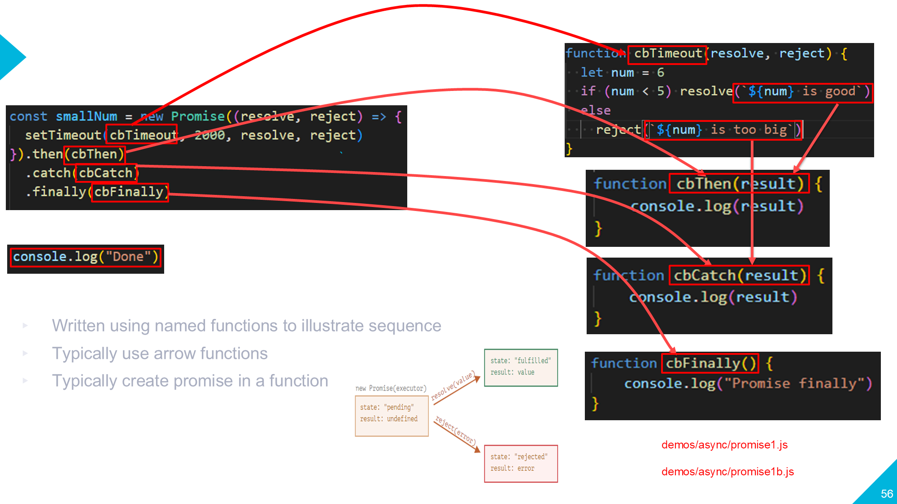
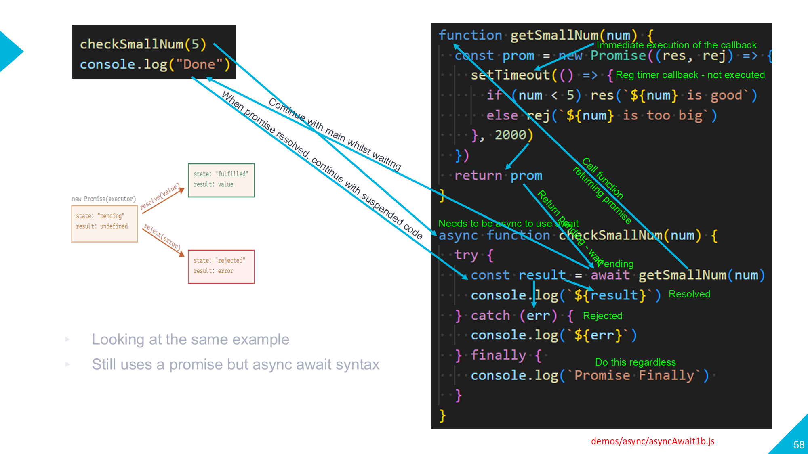

# Async / Await vs .then().catch()
The two demos do the same thing but using a different promise-based construct. They both call a third party API to get a joke and display it in a basic web page.

## .then().catch()
jokes.html loads getJoke.js to get and display a joke
Read and understand this code based on the interactive demo of .then().catch() previously discussed here

To force errors to check response codes and test catch, look in the comments

Demo shows two .then() chained. The resolved promise result from the first .then() is passed to the second one if successful or passed to .catch() if not.

## async / await
This approach uses the more traditional programming approach of using a try / catch block and the code is written more synchronously. A minor limitation of this approach is that the async call being awaited has to be in a function unlike the .then() .catch(). That's not usually a problem but there are some instances where the .then() approach is probably a better choice.

The demo using getJoke.html loading jokes.js illustrates async / await as discussed in the following diagram

# Animations
I've added the animation pptx files for you to run to go through the process of calling and returning from a promise-based asynchronous function for .then() and async/await

# Running the demos
From vscode just F5 on the html page. As it is a frontend only demo, you can set breakpoints in the JavaScript to follow the process through

